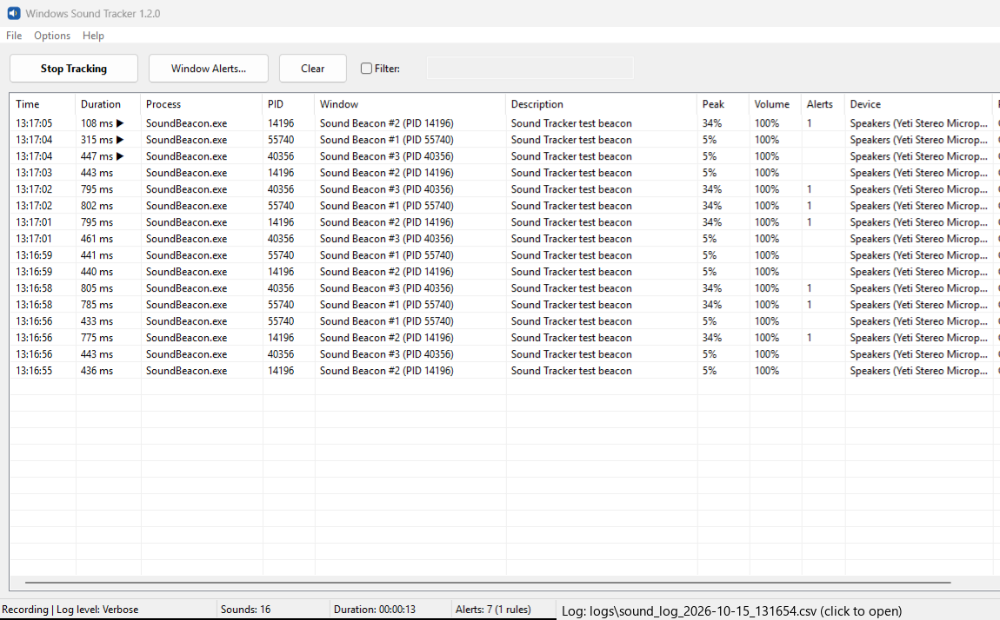

# Windows Sound Tracker

A Windows app that shows which program is making each sound, and can highlight
the window it came from: useful for tracking down mystery noises, and for telling
identical windows apart (for example several game clients played at once).


## What's new in 1.2.0

- **Window Alerts**: when a chosen program gets loud after being quiet, its window
  gets a coloured, click-through border and its taskbar button flashes. Built for
  multiboxing (which of five game clients just played the fishing splash?) but works
  with any app. Includes a live per-window level meter for tuning.
- **Much more accurate detection**: audio levels are sampled every 20 ms instead of
  250 ms, so short sounds aren't missed. Each sound is logged once with its start
  time, duration and peak, instead of a row every quarter second.
- **Real device attribution**: "device connected/disconnected" system sounds name the
  device that actually changed (the old version guessed the first USB device).
- **Window titles for every app** (browsers included, via their audio helper process).
- **Debug logging** for troubleshooting: three levels, crash logs with minidumps, and
  a reason logged for every alert decision. See [docs/TESTING.md](docs/TESTING.md).
- **No administrator rights needed**, settings are saved, single instance, new icon.
- **SoundBeacon** test tool for trying Window Alerts on several windows without a game.

## Features

- Real-time list of every sound: time, duration, process, PID, window, description,
  peak level, volume, output device, path
- Window Alerts with per-rule trigger level, quiet-before, cooldown, ignore-after-input,
  border colour/thickness/duration, taskbar flash
- Automatic CSV log of every sound (`logs/sound_log_*.csv`)
- Filter by process, window title or description; click a row to copy it
- System tray mode; optional start-tracking-on-launch
- Works with every output device at once, follows device changes and unplugging



## Quick start

1. Download `SoundTracker.exe` from [Releases](https://github.com/IronAdamant/windows_sound_tracker/releases) and run it (no install or admin rights needed).
2. Click **Start Tracking** and play something.
3. For window highlighting: **Window Alerts... → Add**, enter the process name (e.g. `Wow.exe`), set a trigger level, **Save rule**.

Settings and logs are kept next to the exe (portable). If that folder isn't writable,
for example under Program Files, they go to `%LOCALAPPDATA%\WindowsSoundTracker` instead.

## Window Alerts

Each rule watches processes by name (wildcards `*` `?`, several names separated by `;`).
An alert fires when the process's audio peak reaches the **trigger level** after it has
been below that level for at least **quiet before** milliseconds. Then:

- a border is drawn over the window(s) of that process, labelled with the rule and PID
  (the border is a separate see-through window: clicks pass through it, and the other
  program is never touched);
- the taskbar button flashes until you switch to that window.

| Setting | What it does |
|---|---|
| Trigger level (%) | Peak level that counts as "the sound". Watch **Recent max** in the live list while the sound plays and set it a bit below that. |
| Quiet before (ms) | The window must be quieter than the trigger level this long first. Stops continuous audio (music) from alerting repeatedly. |
| Must stay loud (ms) | Ignore clicks/blips shorter than this. |
| Cooldown (ms) | Minimum gap between alerts for the same window. |
| Ignore after input (ms) | Skip sounds that start this soon after a key press or mouse click, either in the window you're using or in all windows. Use it for sounds you cause yourself (e.g. casting). |

**Identify all windows** (in the Window Alerts window) draws a labelled border on every
window that currently has audio, which is a quick way to check the PID-to-window mapping.

### Limits worth knowing

- Windows reports loudness **per process**, not per sound. A rule can't tell a splash
  from another equally loud sound in the same window. That's why the game setup below matters.
- All windows/tabs of one browser instance share one audio process, so those windows
  can't be told apart. Separate game clients (separate processes) can.
- The border can't be drawn over minimized windows, windows on other virtual desktops,
  or (possibly) exclusive-fullscreen games. Use windowed or borderless windowed mode.

### World of Warcraft multiboxing (fishing splash)

Each WoW client is its own `Wow.exe` process, so Sound Tracker can tell which window
splashed. In **every** client:

1. **Turn on sound in background.** WoW mutes itself when its window isn't focused,
   and this is **off by default**. Turn on the Sound in Background option in the
   game's audio settings, or type
   `/console Sound_EnableSoundWhenGameIsInBG 1`.
2. Turn **Music**, **Ambience** and **Dialog** off (or very low) and keep **Sound
   Effects** on, so the splash is the loudest thing that client plays.
3. Use **Windowed** or **Windowed (Fullscreen)** display mode.

Then in Sound Tracker: **Window Alerts... → WoW preset → Save rule**, start tracking,
cast in each window and watch **Recent max** when the splash happens. Set the trigger
level a little below the splash and above everything else. The preset ignores sounds
that start within 1.2 s of your own key press or click in that window, so your own cast
sound doesn't trigger it.

The preset matches `Wow.exe`, `WowClassic.exe` and their PTR/beta versions. The debug
log's `Session added` lines show the exact process name if yours differs.

## Build from source

**Visual Studio 2022 or later** (Developer PowerShell):

```powershell
cmake -S . -B build -A x64
cmake --build build --config Release
ctest --test-dir build -C Release      # unit tests
# build\bin\Release\SoundTracker.exe and SoundBeacon.exe
```

Or run `build_release.bat`. Visual Studio's "Open a local folder" and VS Code's CMake
Tools also work with the CMakeLists.txt.

**MinGW-w64 / llvm-mingw** (gcc or clang):

```powershell
cmake -S . -B build -G Ninja -DCMAKE_BUILD_TYPE=Release
cmake --build build
```

Every push is built and unit-tested by GitHub Actions; tags `v*` publish a release.

## CSV log format

One row per sound, written when the sound ends:

```csv
StartTime,DurationMs,ProcessID,ProcessName,ProcessPath,Description,SessionName,WindowTitle,OutputDevice,VolumeLevel,PeakLevel,IsSystemSound,DeviceChange,AlertsFired
2026-10-15 13:09:39.704,795,27536,Wow.exe,C:\...\Wow.exe,World of Warcraft,,World of Warcraft,Speakers (Realtek(R) Audio),100.0%,33.9%,No,,1
```

## Troubleshooting and testing

See **[docs/TESTING.md](docs/TESTING.md)** for the debug log levels, what to look for
in the logs, the SoundBeacon multi-window test, and a browser test checklist.

Command-line options: `--start`, `--debug`, `--verbose`, `--data-dir=PATH`,
`--exit-after=N`, `--test-crash` (checks crash logging). Run `SoundTracker.exe --help`.

## How it works

1. A background thread enumerates every output device (`IMMDeviceEnumerator`) and
   audio session (`IAudioSessionManager2`), and gets notified of new sessions and
   device changes.
2. Each session's peak meter (`IAudioMeterInformation`) is sampled every 20 ms with a
   high-resolution timer.
3. Readings become sounds (start, duration, peak) for the list and CSV, and are run
   through the alert rules (see `src/SoundDetector.cpp`, unit tested in `tests/`).
4. A session's process is mapped to its window. Browsers and Electron apps play audio
   from a windowless child process, so the tracker walks up to the parent.

## Privacy

Only metadata is recorded: which program made a sound, when and how loud. No audio
is recorded or sent anywhere. Window titles (e.g. browser tab names) appear in the
list and logs; turn off **Options → Record Window Titles** if you don't want that.

## Contributing

Contributions are welcome. Please open an issue or pull request.

## License

MIT. See [LICENSE](LICENSE).

## Acknowledgments

- Windows Core Audio API documentation
- Community feedback and testing
- Created with the assistance of AI (Claude) for code development and optimization
